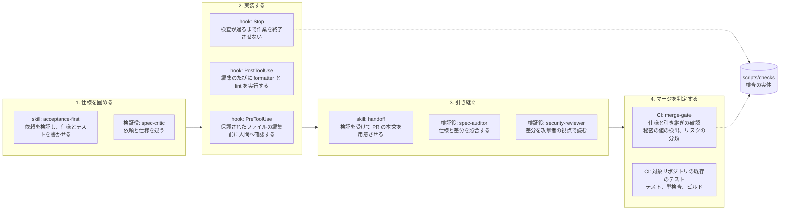
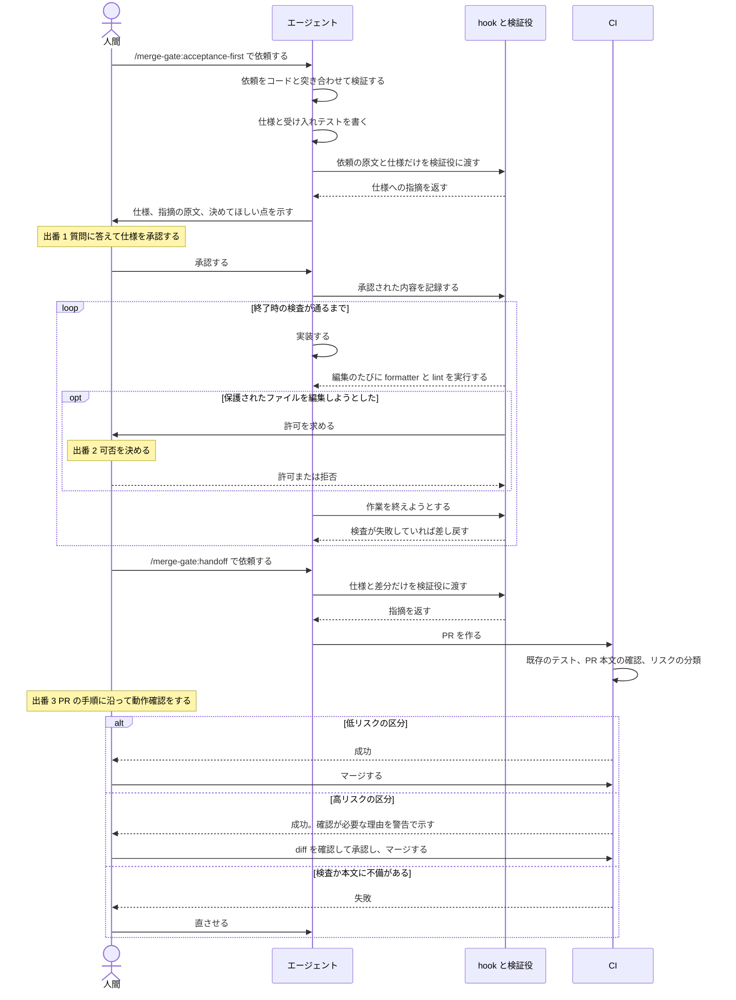

# merge-gate-harness

AI が書いたコードを、人間が diff を読まずにマージできるかを機械的に判定するハーネス。Claude Code のプラグインと、同じ検査を CI から実行する GitHub Action を提供する。

人間が担うのは次の 3 つで、それ以外をハーネスが確認する。

- 実装前の仕様の承認
- 実装後の動作確認
- 高リスクな変更の diff の確認

## 確認する観点

合否を機械的に決められる観点だけを扱う。可読性や設計の良し悪しのように、判定が実行のたびに揺れる観点は扱わない。

| 観点 | 確認する内容 |
| --- | --- |
| 仕様の質 | 依頼の内容をコードと突き合わせてある。受け入れ条件ごとに対応するテストがある |
| 要件適合 | 実装前に承認された受け入れテストが通る |
| デグレなし | 既存のテスト・型検査・ビルドが通る |
| テストの実効性 | テストが今回の変更を実際に検出する。既存テストの変更・削除・skip がない |
| 検査の保全 | lint や型検査を抑制する記述が追加されていない |
| スコープ | 仕様にない変更、依存や設定の変更がない |
| セキュリティ | 秘密の値が追加されていない。認可や入力の扱いに欠陥がない |
| 規約 | formatter と lint が通る |
| 引き継ぎ | 動作確認の手順、エージェントが実行した確認の結果、影響範囲、検証役の実行状況、検証できなかったことが PR に書かれている。その内容が、PR のいまの変更に対して書かれたものである |

パフォーマンスは、対象リポジトリが測定用のコマンドを設定に書いた範囲で検査する。

## 設計の原則

モデルは進化し続ける。いまのモデルの弱点に合わせて作ったハーネスは、モデルが替わると無駄な制約になるか、想定していなかった抜け道を残す。そのため、何を入れて何を入れないかを次の原則で決める。

1. 書き手が誰であっても必要な検査だけを入れる。基準は「書き手が完璧に有能でも、この検査は要るか」である。要るのは、変更が正しいことの証拠と、検査が弱められていないことの確認である。いまのモデルがやりがちな失敗を拾う検査は入れず、必要なリポジトリが設定で足せるようにするに留める
2. やり方を指示せず、結果と証拠を求める。skill に書くのは、いつ承認を得るか、何を証拠として残すか、何を人間の判断に委ねるかである。どう調べ、どう実装するかは書かない
3. 強制は書き手が触れない場所に置く。モデルが賢くなるほど、指示の文面をすり抜ける方法も巧妙になりうる。守らせたいことは文面ではなく CI で守る
4. 合否の判定に LLM を使わない。判定はパス、差分、コマンドの終了コードだけで決めるので、モデルを替えても同じ変更には同じ判定が出る。LLM による検証は人間の判断材料として使う
5. 検証役のモデルを固定しない。探す対象と報告の基準だけを与えるので、新しいモデルに替わればそのまま検証が強くなる
6. 特定の言語やツールの書き方をハーネスに埋め込まない。どのパスを人間の確認に回すか、どの検査を実行するかは対象リポジトリの設定で決める

## 各要素の役割

1 つの変更は 4 つの段階を通る。段階ごとに、次の要素が働く。



要素の種類によって、できることと強制力が違う。

| 種類 | 役割 | 強制力 |
| --- | --- | --- |
| skill | 作業の進め方と、人間の承認を得る時点を示す | ない。守られる保証はない |
| 検証役 | 実装の文脈を持たずに検証し、指摘を返す | ない。指摘は人間の判断材料にする |
| hook | 手元で検査を実行し、通るまで先へ進ませない | ある。ただしプラグインを無効にすれば働かない |
| CI | マージの可否を決める | ある。エージェントからは迂回できない |

hook と skill が働くのは、プラグインを有効にした Claude Code の中だけである。利用者はプラグインを無効にでき、シェルコマンドでファイルを書き換えれば編集前の hook も働かない。そのため、マージの可否は CI の判定で決める。プラグインは、CI で落ちる前にエージェント自身に直させるために使う。

仕様の確認、秘密の値の検出、リスクの分類の実体は `scripts/` のシェルスクリプトで、hook と CI が同じものを呼ぶ。手元で通った変更が CI で落ちるずれを防ぎ、プラグインを読み込まないエージェントで作業した変更にも同じ検査がかかる。

テストや型検査は、このハーネスの CI では実行しない。対象リポジトリの既存の CI が実行しているので、ここでも実行すると二重になる。手元では Stop hook が `checks.verify` のコマンドを実行するので、既存の CI が実行するコマンドと揃えておく。

## 導入

### 1. プラグインを入れる

対象リポジトリで次の 3 つを実行する。3 つ目は自動更新を有効にする。

```bash
claude plugin marketplace add shoooout/merge-gate-harness --scope project
claude plugin install merge-gate@merge-gate-harness --scope project
jq '.extraKnownMarketplaces["merge-gate-harness"].autoUpdate = true' .claude/settings.json > .claude/settings.json.tmp && mv .claude/settings.json.tmp .claude/settings.json
```

`--scope project` は設定を対象リポジトリの `.claude/settings.json` に書く。このファイルを commit すればチームで共有できる。プラグイン本体は各自の端末に入らないので、他の人もそれぞれ `claude plugin install` を 1 回実行する。

#### 自動更新

自動更新を有効にすると、Claude Code が main の最新を自動で取得する。利用者の操作は要らない。

- 更新は、セッションで最初のメッセージを送ったあと、最大 10 分の間を置いて実行される
- 取得した版が使われるのは、次に Claude Code を起動したときからである。実行中のセッションで使うには `/reload-plugins` を実行する
- リポジトリが private の場合は、git が入力なしで認証できる必要がある。SSH の鍵を `ssh-agent` に入れておくか、`gh auth login` のあとに `gh auth setup-git` を実行しておく。認証できないと、更新は何も表示せずに失敗し、古い版が残る
- 環境変数 `DISABLE_AUTOUPDATER`、`DISABLE_UPDATES`、`CLAUDE_CODE_DISABLE_NONESSENTIAL_TRAFFIC` のどれかを設定していると、自動更新は止まる。`FORCE_AUTOUPDATE_PLUGINS=1` を合わせて設定すれば、プラグインの自動更新だけは動く

すぐに最新にしたいときは、次の 2 つを実行する。

```bash
claude plugin marketplace update merge-gate-harness
claude plugin update merge-gate@merge-gate-harness
```

特定の版に固定したいときは、自動更新を有効にせず、`shoooout/merge-gate-harness#v0.1.0` のように `#` のあとにタグを付けて追加する。

<details>
<summary>コマンドを使わず、設定ファイルに直接書く場合</summary>

対象リポジトリの `.claude/settings.json` に次を加える。この場合も、各自が `claude plugin install merge-gate@merge-gate-harness --scope project` を 1 回実行する。

```json
{
  "extraKnownMarketplaces": {
    "merge-gate-harness": {
      "source": { "source": "github", "repo": "shoooout/merge-gate-harness" },
      "autoUpdate": true
    }
  },
  "enabledPlugins": {
    "merge-gate@merge-gate-harness": true
  }
}
```

</details>

### 2. 設定ファイルを置く

対象リポジトリのルートで、雛形を `.merge-gate.json` としてコピーし、`.merge-gate/` を `.gitignore` に加える。

```bash
cp ~/.claude/plugins/marketplaces/merge-gate-harness/examples/merge-gate.json .merge-gate.json
echo '.merge-gate/' >> .gitignore
```

雛形は TypeScript のプロジェクトを想定した例なので、`checks` のコマンドと `paths` を対象リポジトリに合わせて書き換える。各キーの意味は[設定ファイル](#設定ファイル)にある。`.merge-gate.json` がないリポジトリでは hook は何もしない。

`.merge-gate/` には、承認の記録と作業中の仕様が置かれる。手元だけの状態なので commit しない。

### 3. CI に組み込む

このハーネスの CI はテストを実行しない。テストは対象リポジトリの既存の CI に任せ、ハーネスは仕様の確認、秘密の値の検出、リスクの分類だけを行う。組み込み方は 2 つある。

**専用のジョブを置く。** workflow の雛形をコピーする。

```bash
mkdir -p .github/workflows
cp ~/.claude/plugins/marketplaces/merge-gate-harness/examples/workflow.yml .github/workflows/merge-gate.yml
```

**既存のテストのジョブに足す。** テストを実行しているジョブの末尾に、次のステップを足す。言語の実行環境と依存の用意を二重にせずに済む。

```yaml
      - uses: shoooout/merge-gate-harness@main
```

この場合は、既存の workflow の `actions/checkout` に `fetch-depth: 0` を指定しておく。分岐元との差分を取るためである。

どちらの場合も、branch protection を次のように設定する。

- このハーネスのジョブと既存のテストのジョブの両方を、必須のステータスチェックにする。テストを必須にしておかないと、テストが落ちている変更をマージできてしまう
- 人間の承認を必須にする。このハーネスの CI は、承認の有無を確かめない。必須にしておかないと、高リスクの変更を誰も確認しないままマージできてしまう
- 新しいコミットが push されたら、それまでの承認を取り消す設定にする。取り消さないと、承認を得たあとに足した変更が、確認されないままマージされる

このハーネスは PR の本文を検査するので、本文だけを直したときにも検査をやり直す必要がある。雛形の workflow は、`pull_request` の `types` に `edited` を足している。既存のテストのジョブに足した場合は、同じ指定を足すか、本文を直してから push する。`edited` を足すと、本文や題名を直すたびに、そのジョブのテストも実行される。

## CI の判定

次の 2 つは、満たさなければ失敗する。人間の承認があっても通らない。

1. PR の本文に、仕様と引き継ぎの節が中身つきで書かれている。仕様の受け入れ条件ごとに対応するテストがあり、仕様に挙げていない既存テストの変更がない。本文に書かれた変更の識別子が、PR の変更と一致する
2. 秘密の値らしい文字列が追加されていない

テストや型検査が通ることは、ここでは確かめない。対象リポジトリの既存の CI が確かめる。

変更の識別子は、PR の本文に書かれた検証の結果が、どの変更に対するものかを示す。`handoff` が本文の最後に書き、CI が PR の変更から同じ値を計算して比べる。本文を書いたあとに変更が足されると値が変わり、CI は失敗する。エージェントが実行した確認や検証役の結果が、足された変更を見ていないまま残るのを防ぐためである。識別子は、分岐元から変わったファイルと、その変更後の内容から決まる。base ブランチが進んだだけでは変わらない。

そのうえで、次のどれかに当たる変更を高リスクとして扱う。高リスクの変更でも CI は失敗しない。該当した理由を警告として表示し、出力 `auto-merge` を `false` にする。承認があるまでマージさせないのは branch protection の役割である。CI を失敗させないのは、レビューを待っているだけの PR が、上の 2 つの失敗と同じ見た目になるのを避けるためである。

- 分岐元にあったテストの変更・削除、テストへの skip の追加
- lint や型検査を抑制する記述の追加。何が該当するかは `review_markers` で指定する
- テストが検出できない変更
- 依存の定義、検査の設定、`paths.human_review` で指定したパスの変更
- 変更行数の上限の超過

「テストが通った」は、テストが変更を検出できる場合にだけ根拠になる。そこで CI はテスト以外の変更を一時的に分岐元の状態に戻して検査を実行し、失敗することを確かめる。戻しても通るなら、追加したテストは今回の変更を何も検証していないか、テストが追加されていない。振る舞いを変えないリファクタリングは必ずこれに当たるので、人間が diff を確認する。

この確認はテストを実行するので、ハーネスのジョブにもテストを実行できる環境が要り、CI の時間が延びる。`checks.red` に軽いコマンドを指定するか、`false` を指定して無効にできる。

## 使い方

導入が済んだリポジトリでの、1 つの変更の流れである。人間の出番は 3 回ある。



### 1. 仕様と受け入れテストを承認する

Claude Code に作業を依頼する。依頼は文章でも issue の番号でもよい。`acceptance-first` は依頼の内容から自動で使われるが、確実に使わせたいときは明示する。

```
/merge-gate:acceptance-first #123 を実装して
```

依頼や issue の内容は正しいとは限らない。エージェントは実装の前に、次の順で仕様を固める。

1. 依頼を検証する。依頼が前提にしている現状の挙動や、挙げている画面や項目が実在するかをコードで確かめる。不具合の修正ではまず再現するテストを書き、再現しなければ仕様を書かずに止まって報告する
2. 仕様と受け入れテストを書く。仕様は `.merge-gate/spec.md` に書く。受け入れ条件ごとに、それを検証するテストの名前を仕様に書く。検討して採らなかった案と、コードで確かめた場所も仕様に残す
3. 仕様の批判を受ける。仕様を書いた文脈を持たない検証役 `spec-critic` が、誤った前提、抜けている条件、既存の挙動との矛盾を探す

そのうえで、エージェントは仕様と検証役の指摘の原文を示し、人間に決めてほしい点を 1 つずつ質問する。依頼とコードが食い違っていた点、推測で置いた前提、変更が必要な既存テストなどである。

それぞれに答え、仕様を承認するか修正を求める。diff を読まない運用では、ここが内容を確認できる唯一の機会になる。承認すると、エージェントは承認の過程で却下が決まった案を仕様に書き足し、仕様とテストを承認済みとして記録して、実装を始める。

### 2. 実装中の確認に答える

実装中は hook が自動で働く。ファイルを編集するたびに formatter と lint が実行される。エージェントが作業を終えようとすると `checks.verify` のコマンドが実行され、失敗していれば、エージェントは終了できず修正を続ける。

エージェントが次のファイルを編集しようとすると、許可を求める確認が出る。理由を読んで可否を決める。

- 承認済みの仕様と受け入れテスト
- 分岐元にすでにあったテスト
- 依存の定義
- `.merge-gate.json`、CI の定義など、検査の強さを左右するファイル

確認が出るのは、仕様を変える必要が出たときか、エージェントがテストのほうを直して通そうとしているときである。後者であれば拒否する。

### 3. PR を準備させる

実装が終わったら、引き継ぎを依頼する。

```
/merge-gate:handoff
```

エージェントは実装の文脈を持たない 2 つの検証役に差分を検証させ、指摘に対応する。続いて、人間に渡す動作確認の手順を自分で実行し、そのうえで PR の本文を用意する。本文は 5 行以内の要点から始まり、仕様、動作確認の手順、実行した確認、影響範囲、独立した検証、検証できなかったこと、人間の確認が必要な理由が続く。仕様の全文は折りたたんで載せる。本文の最後には、検証した変更の識別子が、画面に表示されないコメントとして入る。

PR を作ったあとに変更を足した場合は、もう一度 `/merge-gate:handoff` を依頼する。足した変更について検証をやり直し、本文と識別子を更新するまで、CI は通らない。

### 4. 動作確認をしてマージする

PR の「動作確認の手順」に沿って動作を確かめる。「実行した確認」で実行できなかったとされている手順と、「検証できなかったこと」に挙がっている箇所は、ハーネスが保証していない範囲なので、重点的に確かめる。「独立した検証」に実行できなかった検証役があれば、その観点の検証は受けていない。

CI の結果によって、その先が分かれる。

| CI の結果 | 意味 | すること |
| --- | --- | --- |
| 成功。警告がない | 既存のテストとハーネスの確認が通り、低リスクの区分である | 動作確認ができたらマージする。diff は読まなくてよい |
| 成功。「人間が diff を確認する必要がある」という警告がある | ハーネスの確認は通ったが、高リスクの区分である | 警告と PR の「人間の確認が必要な理由」を見て diff を確認し、問題なければ承認する |
| 失敗 | 既存のテストが落ちているか、PR の本文に不備があるか、検証のあとに変更が足されている | エージェントに直させる |

高リスクの区分でも CI は成功するので、承認する前に警告の有無を確かめる。警告は、ハーネスのジョブの実行結果の画面に表示される。

### 5. すり抜けた不具合を検査に戻す

ハーネスの検査を通ってマージした変更に不具合が見つかったら、修正とは別に、検査の穴をふさぐ。

```
/merge-gate:escaped-defect
```

エージェントは、不具合を持ち込んだ変更と、それがすり抜けた場所を特定し、検査の変更を提案する。提案には、新しい検査がすり抜けた変更を実際に止めることと、問題のなかった変更をどれだけ巻き込むかを添える。検査を足すかどうかは、これを見て人間が決める。

### 補足

- 承認の記録を手で消す必要はない。記録はそれを取ったブランチでだけ有効で、別のブランチでは無視される。同じブランチで新しい依頼を始めたときは、`acceptance-first` が前の記録を消す
- 分岐元から何も変更していない間は、終了時の検査は実行されない。質問への回答や調査だけのやり取りが該当する
- 終了時の検査が失敗したまま、エージェントが何も変更せずに再び終わろうとした場合は、終了を許す。同じ理由で止め続けても進まないためで、その変更は CI で落ちる
- 変更を重ねても検査が通らず、1 回の依頼の中で止めた回数が `limits.max_stop_blocks` を超えた場合も、終了を許す
- 検査が通らないまま終了を許したときは、その旨が画面に表示され、通っていなかった検査が記録される。`handoff` はこの記録を読み、直せなければ PR の「検証できなかったこと」に書く

## 設定ファイル

| キー | 内容 |
| --- | --- |
| `base` | 差分の比較元。省略すると `origin/main` |
| `checks.verify` | 作業の終了時に手元で実行するコマンド。1 つ以上必要。対象リポジトリの既存の CI が実行するコマンドと揃える |
| `checks.red` | テストが変更を検出できるかの確認に使うコマンド。省略すると `checks.verify` を使う。`false` で無効にする |
| `checks.on_edit` | ファイルの編集のたびに実行するコマンド。`pattern` に一致したファイルのパスを、`command` の末尾に引数として付けて実行する |
| `paths.tests` | テストのファイル。分岐元にあるテストの変更と削除を、人間の確認に回す |
| `paths.dependencies` | 依存の定義。変更を人間の確認に回す |
| `paths.gate` | 検査の強さを左右する設定。変更を人間の確認に回す |
| `paths.human_review` | 認証、課金、migration、インフラなど、必ず人間が diff を確認するパス |
| `paths.no_spec` | ドキュメントなど、仕様を要しない変更のパス。変更がこのパスだけなら、PR に仕様がなくても通す |
| `paths.secrets_ignore` | 秘密の値の検査から除外するパス。テスト用の偽の値を置くファイルなど |
| `skip_markers` | テストの skip を表す記述の正規表現。テストに追加されたら人間の確認に回す |
| `review_markers` | 追加されたら人間の確認に回す記述の正規表現。lint や型検査の抑制を指定する。デバッグ出力のように、そのリポジトリで人間に見せたい記述も足せる |
| `secret_patterns` | 秘密の値として検出する形式の正規表現。組み込みの形式に加えて検査する |
| `limits.max_changed_lines` | 変更行数の上限。超えたら人間の確認に回す |
| `limits.max_stop_blocks` | 1 回の依頼の中で、検査が通らない作業の終了を止める回数の上限。超えたら終了を許して人間に知らせる。省略すると 5 |
| `handoff_sections` | PR の本文に必要な節の見出し。省略すると「動作確認の手順」「実行した確認」「影響範囲」「独立した検証」「検証できなかったこと」 |

パスは glob で書く。`*` はディレクトリの区切りもまたぐので、`tests/*` は配下のすべての階層に一致する。

`.merge-gate.json`、`.merge-gate/`、`.github/`、`.claude/` は、設定に書かなくても常に `paths.gate` として扱う。設定で外せるようにすると、設定を書き換えるだけで検査を無効にできてしまう。

## 構成

```
.claude-plugin/   プラグインと marketplace の定義
skills/
  acceptance-first/   依頼を検証し、仕様と受け入れテストを書いて、承認を得てから実装する
  handoff/            独立した検証を受け、人間が動作確認できる PR を準備する
  escaped-defect/     マージ後に見つかった不具合を、次は検査で止まるように検査へ戻す
agents/
  spec-critic         実装の前に、依頼と仕様を疑う
  spec-auditor        実装の後に、仕様と差分を照合する
  security-reviewer   差分を攻撃者の視点で読む
hooks/            scripts/hooks/ を呼ぶだけの定義
scripts/
  checks/             検査の実体。hook と CI の両方から呼ぶ
  hooks/              Claude Code の hook の入出力を、検査に橋渡しする
  lock.sh             承認された仕様とテストを記録し、書き換えを検知する
  change-id.sh        検証した変更の識別子を、PR の本文に書く形で出力する
action.yml        CI から検査を呼ぶ composite action
examples/         対象リポジトリに置くファイルの例
tests/            スクリプトのテスト
```

## 限界

- 既存テストが薄い箇所のデグレは検出できない。検出力は対象リポジトリのテストの網羅度で上限が決まる。`acceptance-first` は変更前に現在の挙動を固定するテストを書かせるが、これは手順であり強制ではない
- 仕様が誤っていれば、どの検査も通ってしまう。依頼の検証と `spec-critic` の指摘は、人間が誤りに気づきやすくするためのもので、最後に決めるのは実装前の人間の承認である。依頼の意図そのものが誤っている場合は防げない
- 人間が仕様を承認したかどうかは、CI からは分からない。CI が確かめるのは、PR に仕様が載っていて形が整っていることまでである
- このブランチで新しく書いた受け入れテストの書き換えは、CI では検知できない。手元の承認の記録との照合で検知するが、記録は迂回できる
- テストが変更を検出できるかの確認は粗い。分岐元の実装に戻すとテストがコンパイルできずに落ちる場合も「検出した」と数える。テストが変更の一部しか検証していなくても、1 つ落ちれば通る
- 秘密の値として検出するのは、秘密鍵と、主要なサービスが発行する鍵やトークンの形式である。任意の文字列のパスワードは検出できない
- 抑制の記述は設定した形しか検知しない。検査の設定ファイル側での無効化はそのファイルを `paths.gate` に加えて守る
- issue に書かれた指示に従わないことは強制できない。skill と検証役に明記しているが、実際に守っているのは、保護されたファイルの編集前の確認と CI である
- 検証役による検証は実行のたびに結果が揺れる。合否の判定には使わず、指摘を PR に残して人間の判断材料にする
- PR を小分けにすれば、変更行数の上限は回避できる
- PR の「実行した確認」と「独立した検証」は、エージェントの申告である。CI が確かめるのは節があることまでで、実際に実行したかどうかは確かめない
- 変更の識別子も、エージェントが書く。検証をやり直さずに識別子だけを書き換えることは防げない。防げるのは、変更を足したあとに、古い検証の結果が誰にも気づかれずに残ることである
- 変更の識別子は、base ブランチの進み具合を含まない。検証したあとに base ブランチが進んでも、CI は検証のやり直しを求めない。逆に、このブランチが変えたファイルを base ブランチも変えていた場合は、base ブランチを取り込むだけで識別子が変わる
- ログインが要る手順を、エージェントが実行できるとは限らない。ハーネスは、検証用のアカウントの用意を対象リポジトリに求めない。エージェントが使うのは、リポジトリに既存の手段、手元の環境で作れるアカウント、人間がログイン済みのブラウザである。どれも使えない手順は「実行できなかった」として人間に渡る
- 手元の検査と CI のテストは、同じコマンドとは限らない。手元の Stop hook は `checks.verify` を実行し、CI では対象リポジトリの既存の workflow がテストを実行する。両者がずれていると、手元で通った変更が CI で落ちる
- 受け入れ条件とテストは、仕様に書いたテストの名前で対応づける。名前が一致するテストが追加されていることは確かめるが、そのテストが条件を本当に検証しているかは機械的には確かめない。この確認は検証役 `spec-auditor` と人間が担う
- マージ後に見つかった不具合を検査に戻す `escaped-defect` は、手順であり強制ではない。人間が依頼しなければ実行されない

## 開発

このリポジトリは検査の定義そのものなので、変更は必ず人間がレビューしてからマージする。

```bash
bash tests/run.sh
claude plugin validate .
```

スクリプトは macOS 標準の bash 3.2 でも動くように書く。外部コマンドは `git` と `jq` だけに依存する。

CI がテストを実行するのは Ubuntu だけである。bash 3.2 での動作は CI では確かめていないので、push の前に macOS の手元で `bash tests/run.sh` を実行する。

手元で試すには、対象リポジトリで次のように起動する。

```bash
claude --plugin-dir /path/to/merge-gate-harness
```
