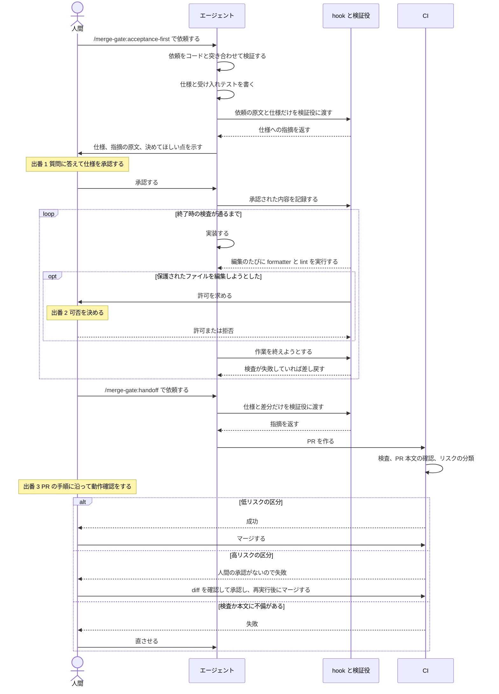

# merge-gate-harness

AI が書いたコードを、人間が diff を読まずにマージできるかを機械的に判定するハーネス。Claude Code のプラグインと、同じ検査を CI から呼ぶための GitHub Action を 1 つのリポジトリで提供する。

人間が担うのは、実装前の仕様の承認、実装後の動作確認、高リスクな変更の diff の確認の 3 つである。それ以外をこのハーネスが確認する。

## 何を確認するか

合否を機械的に決められる観点だけを扱う。可読性や設計の良し悪しのように、判定が実行のたびに揺れる観点は対象にしない。

| 観点 | 確認する内容 | 仕組み |
| --- | --- | --- |
| 仕様の質 | 依頼の内容をコードと突き合わせてある。必要な節が揃い、受け入れ条件ごとに対応するテストがある | skill、sub agent、Stop hook、CI |
| 要件適合 | 実装前に承認された受け入れテストが通る。PR に仕様が載っている | skill、Stop hook、CI |
| デグレなし | 既存のテスト・型検査・ビルドが通る | Stop hook、CI |
| テストの実効性 | テストが今回の変更を実際に検出する。既存テストの変更・削除・skip がない。承認済みのテストが書き換えられていない | PreToolUse hook、Stop hook、CI、sub agent |
| 検査の保全 | lint や型検査を黙らせる記述が追加されていない | CI |
| スコープ | 仕様にない変更、依存や設定の変更がない | PreToolUse hook、CI、sub agent |
| セキュリティ | 秘密の値が追加されていない。対象リポジトリが指定したスキャンが通る。認可や入力の扱いに欠陥がない | Stop hook、CI、sub agent |
| 機械的な規約 | formatter と lint が通る | PostToolUse hook、CI |
| 人間への引き継ぎ | 動作確認の手順、影響範囲、検証できなかったことが PR に書かれている | skill、CI |

パフォーマンスの検査は、対象リポジトリが測定用のコマンドを `checks.verify` か `checks.ci` に書いた範囲で行う。

## 設計の原則

モデルは進化し続ける。いまのモデルの弱点に合わせて作ったハーネスは、モデルが替わると無駄な制約になるか、想定していなかった抜け道を残す。このハーネスに何を入れ、何を入れないかは、次の原則で決める。

**書き手が誰であっても必要な検査だけを入れる。** 判断の基準は「書き手が完璧に有能でも、この検査は要るか」である。要るのは、変更が正しいことの証拠と、ゲートが保たれていることの確認である。証拠は、書き手の能力がどれだけ高くても、書き手の申告とは別に必要になる。反対に、デバッグ出力の置き忘れや読みにくい命名のように、いまのモデルがやりがちな失敗を拾う検査は入れない。必要なリポジトリが設定で足せるようにするに留める。

**やり方を指示せず、結果と証拠を求める。** skill に書くのは、人間との約束事である。いつ承認を得るか、何を証拠として残すか、何を人間の判断に委ねるかを決める。どう調べ、どう実装するかは書かない。モデルが賢くなれば、やり方はモデルのほうがうまく選ぶ。

**強制は、書き手が触れない場所に置く。** モデルが賢くなるほど、指示の文面をすり抜ける方法も巧妙になりうる。そのため、守らせたいことは文面ではなく、CI と、ゲートを書き換える変更を人間に回す仕組みで守る。

**合否の判定に LLM を使わない。** 判定はパス、差分、コマンドの終了コードだけで決める。モデルを替えても、同じ変更には同じ判定が出る。LLM による検証は、人間の判断材料として使う。

**検証役のモデルを固定しない。** 検証役はモデルを指定せず、探す対象と報告の基準だけを与える。新しいモデルに替われば、そのまま検証が強くなる。

**仕組みはハーネスに、中身は設定に置く。** 特定の言語やツールの書き方を、ハーネスに埋め込まない。どのパスを人間に回すか、どの記述を抑制とみなすか、どの検査を実行するかは、対象リポジトリの設定で決める。人間に回す範囲は、実績を見ながら設定で広げも狭めもできる。

新しい検査を足すときは、最初の原則に照らす。「モデルが次の世代になっても、この検査は意味を持つか」に答えられないものは、ハーネスに入れず、設定で表せる形を探す。

## 最終的な合否は CI で決める

hook と skill が効くのは、プラグインを有効にした Claude Code の中だけである。利用者はプラグインを無効にでき、シェルコマンドでファイルを書き換えれば PreToolUse hook も通らない。そのため、プラグインは「CI で落ちる前にエージェント自身に直させる」ためのものと位置づけ、マージの可否は CI の判定で決める。

検査の実体は `scripts/` のシェルスクリプトで、hook と CI の両方が同じものを呼ぶ。手元で通ったものが CI で落ちるずれを防ぎ、プラグインを読み込まないエージェントで作業した変更も同じ検査を受ける。

## 構成

```
.claude-plugin/   プラグインと marketplace の定義
skills/           作業の手順
  acceptance-first/   依頼を検証し、仕様と受け入れテストを書いて、承認を得てから実装する
  handoff/            独立した検証を受け、人間が動作確認できる PR を準備する
agents/           実装の文脈を引き継がない検証役
  spec-critic         実装の前に、依頼と仕様を疑う
  spec-auditor        実装の後に、仕様と差分を照合する
  security-reviewer   差分を攻撃者の視点で読む
hooks/            scripts/hooks/ を呼ぶだけの定義
scripts/
  checks/             検査の実体。hook と CI の両方から呼ぶ
  hooks/              Claude Code の hook の入出力を、検査に橋渡しする
  lock.sh             承認された仕様とテストを記録し、書き換えを検知する
action.yml        CI から検査を呼ぶ composite action
examples/         対象リポジトリに置くファイルの例
tests/            スクリプトのテスト
```

## 対象リポジトリへの導入

### 1. プラグインを有効にする

対象リポジトリで次の 2 つを実行する。

```bash
claude plugin marketplace add shoooout/merge-gate-harness#v0.1.0 --scope project
claude plugin install merge-gate@merge-gate-harness --scope project
```

`#` のあとにタグを付けて、バージョンを固定する。固定しないと、ハーネスの変更で全リポジトリが同時に影響を受ける。

`--scope` で、どこに登録するかを選ぶ。

| scope | 登録先 | 向いている場面 |
| --- | --- | --- |
| `project` | 対象リポジトリの `.claude/settings.json` | チームで共有する |
| `local` | 対象リポジトリの、commit しない個人設定 | そのリポジトリで自分だけ試す |
| `user` | 自分の全リポジトリ | 自分だけで使う |

`project` を選んだ場合は、コマンドが書き換えた `.claude/settings.json` を commit する。設定が共有されても、プラグイン本体は各自の端末に入らないので、他の人もそれぞれ `claude plugin install` を 1 回実行する。

<details>
<summary>コマンドを使わず、設定ファイルに直接書く場合</summary>

対象リポジトリの `.claude/settings.json` に次を加える。この場合も、各自が `claude plugin install merge-gate@merge-gate-harness --scope project` を 1 回実行する必要がある。

```json
{
  "extraKnownMarketplaces": {
    "merge-gate-harness": {
      "source": { "source": "github", "repo": "shoooout/merge-gate-harness", "ref": "v0.1.0" }
    }
  },
  "enabledPlugins": {
    "merge-gate@merge-gate-harness": true
  }
}
```

</details>

### 2. 設定ファイルを置く

対象リポジトリのルートで、雛形を `.merge-gate.json` としてコピーする。1 で追加した marketplace は、端末の `~/.claude/plugins/marketplaces/merge-gate-harness/` に置かれている。

```bash
cp ~/.claude/plugins/marketplaces/merge-gate-harness/examples/merge-gate.json .merge-gate.json
```

雛形は TypeScript のプロジェクトを想定した例なので、コピーしたあとに `checks` のコマンドと `paths` を、対象リポジトリに合わせて書き換える。各キーの意味は[設定ファイル](#設定ファイル)にある。このファイルがないリポジトリでは、hook は何もしない。

続けて、`.gitignore` に `.merge-gate/` を加える。承認の記録と作業中の仕様を置く、手元だけの状態である。

```bash
echo '.merge-gate/' >> .gitignore
```

### 3. CI に組み込む

workflow の雛形をコピーし、言語の実行環境と依存を用意するステップを書き足す。

```bash
mkdir -p .github/workflows
cp ~/.claude/plugins/marketplaces/merge-gate-harness/examples/workflow.yml .github/workflows/merge-gate.yml
```

そのうえで、branch protection でこのジョブを必須のステータスチェックにする。

CI は次の順で判定する。

1. `checks.verify` と `checks.ci` のコマンドがすべて通る
2. PR の本文に、仕様と、引き継ぎに必要な節が中身つきで書かれている。仕様の受け入れ条件ごとに対応するテストがあり、仕様に挙げていない既存テストの変更がない
3. 秘密の値らしい文字列が追加されていない
4. 変更が「人間の確認が必要な区分」に当たらない。当たる場合は、最新のコミットに対する人間の承認がある

1 から 3 は、人間の承認があっても通らない。4 によって、低リスクの変更は承認なしで通り、高リスクの変更は人間が承認するまで通らない。

人間の確認が必要な区分に入るのは、次の変更である。

- 分岐元にあったテストの変更・削除、テストへの skip の追加
- 検査を黙らせる記述の追加。何が該当するかは `review_markers` で指定する
- テストが検出できない変更。テスト以外の変更を分岐元の状態に戻しても検査が通る場合が該当する
- 依存の定義、ゲートの設定、`paths.human_review` で指定したパスの変更
- 変更行数の上限の超過

### テストが変更を検出できるかの確認

「テストが通った」は、テストが変更を検出できる場合にだけ根拠になる。CI は、テスト以外の変更を一時的に分岐元の状態に戻して検査を実行し、失敗することを確かめる。戻しても通るなら、追加したテストは今回の変更を何も検証していないか、テストが追加されていない。

振る舞いを変えないリファクタリングは、この確認では必ず「検出できない」になる。その場合は人間が diff を確認する。テストで守れない変更を自動で通さないための、意図した挙動である。

この確認は検査をもう一度実行するので、CI の時間が延びる。`checks.red` に軽いコマンドを指定するか、`false` を指定して無効にできる。

## 使い方

導入が済んだリポジトリでの、1 つの変更の流れである。人間の出番は 3 回ある。



### 1. 仕様と受け入れテストを承認する

Claude Code に作業を依頼する。`acceptance-first` は依頼の内容から自動で使われるが、確実に使わせたいときは明示する。

```
/merge-gate:acceptance-first 注文一覧に、キャンセル済みの注文を除外する絞り込みを追加して
```

issue の番号を渡すだけでもよい。

```
/merge-gate:acceptance-first #123 を実装して
```

依頼や issue の内容は、正しいとは限らない。エージェントは実装の前に、次の順で仕様を固める。

1. **依頼を検証する。** 依頼が前提にしている現状の挙動や、挙げている画面や項目が実在するかを、コードで確かめる。不具合の修正では、まず再現するテストを書く。再現しなければ、仕様を書かずに止まって報告する
2. **仕様と受け入れテストを書く。** 仕様は `.merge-gate/spec.md` に書く。受け入れ条件には `AC-1` のような番号を付け、対応するテストに同じ番号を書く
3. **仕様の批判を受ける。** 仕様を書いた文脈を持たない検証役 `spec-critic` が、誤った前提、抜けている条件、既存の挙動との矛盾を探す

そのうえで、仕様、検証役の指摘の原文、人間に決めてほしい点を提示する。

**人間の出番 1:** 決めてほしい点は、1 つずつ質問として出てくる。依頼とコードが食い違っていた点、推測で置いた前提、変更が必要な既存テストなどである。それぞれに答え、仕様を承認するか修正を求める。diff を読まない運用では、ここが内容を確認できる唯一の機会になる。

承認すると、エージェントは仕様とテストを承認済みとして記録し、実装を始める。

### 2. 実装中の確認に答える

実装中は hook が自動で働く。操作は要らない。

- ファイルを編集するたびに、formatter と lint が実行される
- エージェントが作業を終えようとすると、`checks.verify` のコマンドが実行される。失敗していれば、エージェントは終了できず修正を続ける

**人間の出番 2:** エージェントが次のファイルを編集しようとすると、許可を求める確認が出る。理由を読んで可否を決める。

- 承認済みの仕様と受け入れテスト
- 分岐元にすでにあったテスト
- 依存の定義
- `.merge-gate.json`、CI の定義など、検査の強さを左右するファイル

確認が出るのは、仕様を変える必要が出たときか、エージェントがテストのほうを直して通そうとしているときである。後者であれば拒否する。

### 3. PR を準備させる

実装が終わったら、引き継ぎを依頼する。

```
/merge-gate:handoff
```

エージェントは、実装の文脈を持たない 2 つの検証役に差分を検証させ、指摘に対応したうえで、PR の本文を用意する。本文には、動作確認の手順、影響範囲、検証できなかったこと、人間の確認が必要な理由が入る。

### 4. 動作確認をしてマージする

**人間の出番 3:** PR の「動作確認の手順」に沿って動作を確かめる。「検証できなかったこと」に挙がっている箇所は、ハーネスが保証していない範囲なので、重点的に確かめる。

CI の結果によって、その先が分かれる。

| CI の結果 | 意味 | すること |
| --- | --- | --- |
| 成功 | 検査が通り、低リスクの区分である | 動作確認ができたらマージする。diff は読まなくてよい |
| 「人間の承認がない」で失敗 | 検査は通ったが、高リスクの区分である | PR の「人間の確認が必要な理由」を見て diff を確認し、問題なければ承認する。承認すると CI が再実行されて通る |
| それ以外で失敗 | 検査か PR の本文に不備がある | エージェントに直させる |

承認のあとにコミットが積まれると、その承認は数えられなくなる。最新のコミットに対して承認し直す。

### 補足

- 作業をやり直すとき、またはマージしたあとは、承認の記録を消す。`bash <プラグインのパス>/scripts/lock.sh clear` を実行するか、`.merge-gate/` を削除する
- 質問への回答や調査だけのやり取りでは、検査は実行されない。分岐元から何も変更していない間は、終了時の検査を省いている
- 終了時の検査が失敗したまま、エージェントが何も変更せずに再び終わろうとした場合は、終了を許す。同じ理由で止め続けても進まないためで、その変更は CI で落ちる

## 設定ファイル

| キー | 内容 |
| --- | --- |
| `base` | 差分の比較元。省略すると `origin/main` |
| `checks.verify` | 作業の終了時と CI で実行するコマンド。1 つ以上必要 |
| `checks.ci` | CI でだけ実行するコマンド。mutation testing やスキャンのように時間がかかるものを置く |
| `checks.red` | テストが変更を検出できるかの確認に使うコマンド。省略すると `checks.verify` を使う。`false` で無効にする |
| `checks.on_edit` | ファイルの編集のたびに実行するコマンド。`pattern` に一致したファイルのパスを、`command` の末尾に引数として付けて実行する |
| `paths.tests` | テストのファイル。分岐元にあるテストの変更と削除を、人間の確認に回す |
| `paths.dependencies` | 依存の定義。変更を人間の確認に回す |
| `paths.gate` | 検査の強さを左右する設定。変更を人間の確認に回す |
| `paths.human_review` | 認証、課金、migration、インフラなど、必ず人間が diff を確認するパス |
| `paths.no_spec` | 仕様を要しない変更のパス。ドキュメントなど。変更がこのパスだけなら、PR に仕様がなくても通す |
| `paths.secrets_ignore` | 秘密の値の検査から除外するパス。テスト用の偽の値を置くファイルなど |
| `skip_markers` | テストの skip を表す記述の正規表現。テストに追加されたら人間の確認に回す |
| `review_markers` | 追加されたら人間の確認に回す記述の正規表現。lint や型検査の抑制を指定する。デバッグ出力のように、そのリポジトリで人間に見せたい記述も足せる |
| `secret_patterns` | 秘密の値として検出する形式の正規表現。組み込みの形式に加えて検査する |
| `limits.max_changed_lines` | 変更行数の上限。超えたら人間の確認に回す |
| `handoff_sections` | PR の本文に必要な節の見出し。省略すると「動作確認の手順」「影響範囲」「検証できなかったこと」 |

パスは glob で書く。`*` はディレクトリの区切りもまたぐので、`tests/*` は配下のすべての階層に一致する。

`.merge-gate.json`、`.merge-gate/`、`.github/`、`.claude/` は、設定に書かなくても常に `paths.gate` として扱う。設定で外せるようにすると、設定を書き換えるだけでゲートを無効にできてしまう。

## このリポジトリ自体の扱い

このリポジトリはゲートの定義そのものなので、変更は必ず人間がレビューしてからマージする。自動マージの対象にしない。

## 限界

- **既存テストが薄い箇所のデグレは検出できない。** 検出力は対象リポジトリのテストの網羅度で上限が決まる。`acceptance-first` は変更前に現在の挙動を固定するテストを書かせるが、これは手順であり強制ではない
- **仕様が誤っていれば、どの検査も通ってしまう。** 仕様が正しいかどうかは機械的には決められない。依頼の検証と `spec-critic` の指摘は、人間が誤りに気づきやすくするためのもので、最後に決めるのは実装前の人間の承認である。依頼の意図そのものが誤っている場合は防げない
- **人間が仕様を承認したかどうかは、CI からは分からない。** CI が確かめるのは、PR に仕様が載っていて形が整っていることまでである。承認を経ずに書かれた仕様でも、形が整っていれば通る
- **受け入れ条件の番号がテストに残る。** 対応を機械的に追うために `AC-1` のような番号をテストに書くので、マージ後は意味を持たない番号がテストに残る
- **このブランチで新しく書いた受け入れテストの書き換えは、CI では検知できない。** 手元の承認の記録との照合で検知するが、記録は手元の状態であり、迂回できる。CI が確実に検知するのは、分岐元にあったテストの変更だけである
- **sub agent による検証は実行のたびに結果が揺れる。** 合否の判定には使わず、指摘を PR に残して人間の判断材料にする
- **PR を小分けにすれば、変更行数の上限は回避できる。**
- **テストが変更を検出できるかの確認は、粗い。** 分岐元の実装に戻すとテストがコンパイルできずに落ちる場合も「検出した」と数える。テストが変更の一部しか検証していなくても、1 つ落ちれば通る
- **秘密の値の検出は、形式が決まっているものに限る。** 組み込みで検出するのは、秘密鍵と、主要なサービスが発行する鍵やトークンである。任意の文字列のパスワードは検出できない
- **検査を黙らせる記述は、設定した形しか検知しない。** 設定にない抑制の書き方や、検査の設定ファイル側での無効化は検知できない。後者は `paths.gate` に設定ファイルを加えて守る
- **issue に書かれた指示に従わないことは、強制できない。** skill と検証役に明記しているが、文面による指示である。実際に守っているのは、保護されたファイルの編集前の確認と CI である

## 開発

```bash
bash tests/run.sh
claude plugin validate .
```

スクリプトは macOS 標準の bash 3.2 でも動くように書く。外部コマンドは `git` と `jq` だけに依存する。

手元で試すには、対象リポジトリで次のように起動する。

```bash
claude --plugin-dir /path/to/merge-gate-harness
```
