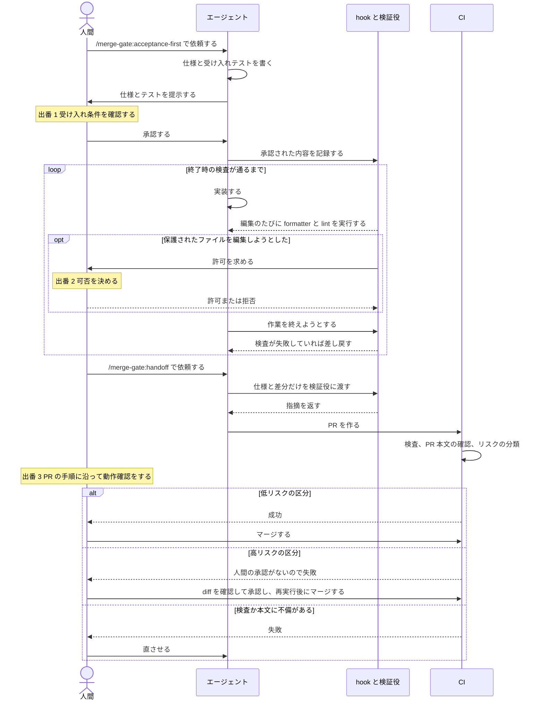

# merge-gate-harness

AI が書いたコードを、人間が diff を読まずにマージできるかを機械的に判定するハーネス。Claude Code のプラグインと、同じ検査を CI から呼ぶための GitHub Action を 1 つのリポジトリで提供する。

人間が担うのは、実装前の仕様の承認、実装後の動作確認、高リスクな変更の diff の確認の 3 つである。それ以外をこのハーネスが確認する。

## 何を確認するか

合否を機械的に決められる観点だけを扱う。可読性や設計の良し悪しのように、判定が実行のたびに揺れる観点は対象にしない。

| 観点 | 確認する内容 | 仕組み |
| --- | --- | --- |
| 要件適合 | 実装前に承認された受け入れテストが通る | skill、Stop hook、CI |
| デグレなし | 既存のテスト・型検査・ビルドが通る | Stop hook、CI |
| テストの実効性 | 既存テストの変更・削除・skip がない。承認済みのテストが書き換えられていない | PreToolUse hook、Stop hook、CI、sub agent |
| スコープ | 仕様にない変更、依存や設定の変更がない | PreToolUse hook、CI、sub agent |
| セキュリティ | 対象リポジトリが指定したスキャンが通る。認可や入力の扱いに欠陥がない | CI、sub agent |
| 機械的な規約 | formatter と lint が通る | PostToolUse hook、CI |
| 人間への引き継ぎ | 動作確認の手順、影響範囲、検証できなかったことが PR に書かれている | skill、CI |

パフォーマンスの検査は、対象リポジトリが測定用のコマンドを `checks.verify` か `checks.ci` に書いた範囲で行う。

## 最終的な合否は CI で決める

hook と skill が効くのは、プラグインを有効にした Claude Code の中だけである。利用者はプラグインを無効にでき、シェルコマンドでファイルを書き換えれば PreToolUse hook も通らない。そのため、プラグインは「CI で落ちる前にエージェント自身に直させる」ためのものと位置づけ、マージの可否は CI の判定で決める。

検査の実体は `scripts/` のシェルスクリプトで、hook と CI の両方が同じものを呼ぶ。手元で通ったものが CI で落ちるずれを防ぎ、プラグインを読み込まないエージェントで作業した変更も同じ検査を受ける。

## 構成

```
.claude-plugin/   プラグインと marketplace の定義
skills/           作業の手順
  acceptance-first/   仕様と受け入れテストを先に書き、承認を得てから実装する
  handoff/            独立した検証を受け、人間が動作確認できる PR を準備する
agents/           実装の文脈を引き継がない検証役
  spec-auditor        仕様と差分を照合する
  security-reviewer   差分を攻撃者の視点で読む
hooks/            scripts/hooks/ を呼ぶだけの定義
scripts/
  checks/             検査の実体。hook と CI の両方から呼ぶ
  hooks/              Claude Code の hook の入出力を、検査に橋渡しする
  lock.sh             承認された仕様とテストを記録し、書き換えを検知する
action.yml        CI から検査を呼ぶ composite action
examples/         対象リポジトリに置くファイルの例
tests/            スクリプトのテスト
```

## 対象リポジトリへの導入

### 1. プラグインを有効にする

対象リポジトリで次の 2 つを実行する。

```bash
claude plugin marketplace add shoooout/merge-gate-harness#v0.0.1 --scope project
claude plugin install merge-gate@merge-gate-harness --scope project
```

`#` のあとにタグを付けて、バージョンを固定する。固定しないと、ハーネスの変更で全リポジトリが同時に影響を受ける。

`--scope` で、どこに登録するかを選ぶ。

| scope | 登録先 | 向いている場面 |
| --- | --- | --- |
| `project` | 対象リポジトリの `.claude/settings.json` | チームで共有する |
| `local` | 対象リポジトリの、commit しない個人設定 | そのリポジトリで自分だけ試す |
| `user` | 自分の全リポジトリ | 自分だけで使う |

`project` を選んだ場合は、コマンドが書き換えた `.claude/settings.json` を commit する。設定が共有されても、プラグイン本体は各自の端末に入らないので、他の人もそれぞれ `claude plugin install` を 1 回実行する。

<details>
<summary>コマンドを使わず、設定ファイルに直接書く場合</summary>

対象リポジトリの `.claude/settings.json` に次を加える。この場合も、各自が `claude plugin install merge-gate@merge-gate-harness --scope project` を 1 回実行する必要がある。

```json
{
  "extraKnownMarketplaces": {
    "merge-gate-harness": {
      "source": { "source": "github", "repo": "shoooout/merge-gate-harness", "ref": "v0.0.1" }
    }
  },
  "enabledPlugins": {
    "merge-gate@merge-gate-harness": true
  }
}
```

</details>

### 2. 設定ファイルを置く

対象リポジトリのルートで、雛形を `.merge-gate.json` としてコピーする。1 で追加した marketplace は、端末の `~/.claude/plugins/marketplaces/merge-gate-harness/` に置かれている。

```bash
cp ~/.claude/plugins/marketplaces/merge-gate-harness/examples/merge-gate.json .merge-gate.json
```

雛形は TypeScript のプロジェクトを想定した例なので、コピーしたあとに `checks` のコマンドと `paths` を、対象リポジトリに合わせて書き換える。各キーの意味は[設定ファイル](#設定ファイル)にある。このファイルがないリポジトリでは、hook は何もしない。

続けて、`.gitignore` に `.merge-gate/` を加える。承認の記録と作業中の仕様を置く、手元だけの状態である。

```bash
echo '.merge-gate/' >> .gitignore
```

### 3. CI に組み込む

workflow の雛形をコピーし、言語の実行環境と依存を用意するステップを書き足す。

```bash
mkdir -p .github/workflows
cp ~/.claude/plugins/marketplaces/merge-gate-harness/examples/workflow.yml .github/workflows/merge-gate.yml
```

そのうえで、branch protection でこのジョブを必須のステータスチェックにする。

CI は次の順で判定する。

1. `checks.verify` と `checks.ci` のコマンドがすべて通る
2. PR の本文に、引き継ぎに必要な節が中身つきで書かれている
3. 変更が「人間の確認が必要な区分」に当たらない。当たる場合は、最新のコミットに対する人間の承認がある

3 によって、低リスクの変更は承認なしで通り、高リスクの変更は人間が承認するまで通らない。

## 使い方

導入が済んだリポジトリでの、1 つの変更の流れである。人間の出番は 3 回ある。



### 1. 仕様と受け入れテストを承認する

Claude Code に作業を依頼する。`acceptance-first` は依頼の内容から自動で使われるが、確実に使わせたいときは明示する。

```
/merge-gate:acceptance-first 注文一覧に、キャンセル済みの注文を除外する絞り込みを追加して
```

エージェントは実装の前に、仕様を `.merge-gate/spec.md` に書き、受け入れ条件ごとのテストを書いて、それらを提示する。

**人間の出番 1:** 受け入れ条件が頼んだ内容と合っているかを確かめ、承認するか修正を求める。diff を読まない運用では、ここが内容を確認できる唯一の機会になる。

承認すると、エージェントは仕様とテストを承認済みとして記録し、実装を始める。

### 2. 実装中の確認に答える

実装中は hook が自動で働く。操作は要らない。

- ファイルを編集するたびに、formatter と lint が実行される
- エージェントが作業を終えようとすると、`checks.verify` のコマンドが実行される。失敗していれば、エージェントは終了できず修正を続ける

**人間の出番 2:** エージェントが次のファイルを編集しようとすると、許可を求める確認が出る。理由を読んで可否を決める。

- 承認済みの仕様と受け入れテスト
- 分岐元にすでにあったテスト
- 依存の定義
- `.merge-gate.json`、CI の定義など、検査の強さを左右するファイル

確認が出るのは、仕様を変える必要が出たときか、エージェントがテストのほうを直して通そうとしているときである。後者であれば拒否する。

### 3. PR を準備させる

実装が終わったら、引き継ぎを依頼する。

```
/merge-gate:handoff
```

エージェントは、実装の文脈を持たない 2 つの検証役に差分を検証させ、指摘に対応したうえで、PR の本文を用意する。本文には、動作確認の手順、影響範囲、検証できなかったこと、人間の確認が必要な理由が入る。

### 4. 動作確認をしてマージする

**人間の出番 3:** PR の「動作確認の手順」に沿って動作を確かめる。「検証できなかったこと」に挙がっている箇所は、ハーネスが保証していない範囲なので、重点的に確かめる。

CI の結果によって、その先が分かれる。

| CI の結果 | 意味 | すること |
| --- | --- | --- |
| 成功 | 検査が通り、低リスクの区分である | 動作確認ができたらマージする。diff は読まなくてよい |
| 「人間の承認がない」で失敗 | 検査は通ったが、高リスクの区分である | PR の「人間の確認が必要な理由」を見て diff を確認し、問題なければ承認する。承認すると CI が再実行されて通る |
| それ以外で失敗 | 検査か PR の本文に不備がある | エージェントに直させる |

承認のあとにコミットが積まれると、その承認は数えられなくなる。最新のコミットに対して承認し直す。

### 補足

- 作業をやり直すとき、またはマージしたあとは、承認の記録を消す。`bash <プラグインのパス>/scripts/lock.sh clear` を実行するか、`.merge-gate/` を削除する
- 質問への回答や調査だけのやり取りでは、検査は実行されない。分岐元から何も変更していない間は、終了時の検査を省いている
- 終了時の検査が失敗したまま、エージェントが何も変更せずに再び終わろうとした場合は、終了を許す。同じ理由で止め続けても進まないためで、その変更は CI で落ちる

## 設定ファイル

| キー | 内容 |
| --- | --- |
| `base` | 差分の比較元。省略すると `origin/main` |
| `checks.verify` | 作業の終了時と CI で実行するコマンド。1 つ以上必要 |
| `checks.ci` | CI でだけ実行するコマンド。mutation testing やスキャンのように時間がかかるものを置く |
| `checks.on_edit` | ファイルの編集のたびに実行するコマンド。`pattern` に一致したファイルのパスを、`command` の末尾に引数として付けて実行する |
| `paths.tests` | テストのファイル。分岐元にあるテストの変更と削除を、人間の確認に回す |
| `paths.dependencies` | 依存の定義。変更を人間の確認に回す |
| `paths.gate` | 検査の強さを左右する設定。変更を人間の確認に回す |
| `paths.human_review` | 認証、課金、migration、インフラなど、必ず人間が diff を確認するパス |
| `skip_markers` | テストの skip を表す記述の正規表現。テストに追加されたら人間の確認に回す |
| `limits.max_changed_lines` | 変更行数の上限。超えたら人間の確認に回す |
| `handoff_sections` | PR の本文に必要な節の見出し。省略すると「動作確認の手順」「影響範囲」「検証できなかったこと」 |

パスは glob で書く。`*` はディレクトリの区切りもまたぐので、`tests/*` は配下のすべての階層に一致する。

`.merge-gate.json`、`.merge-gate/`、`.github/`、`.claude/` は、設定に書かなくても常に `paths.gate` として扱う。設定で外せるようにすると、設定を書き換えるだけでゲートを無効にできてしまう。

## このリポジトリ自体の扱い

このリポジトリはゲートの定義そのものなので、変更は必ず人間がレビューしてからマージする。自動マージの対象にしない。

## 限界

- **既存テストが薄い箇所のデグレは検出できない。** 検出力は対象リポジトリのテストの網羅度で上限が決まる。`acceptance-first` は変更前に現在の挙動を固定するテストを書かせるが、これは手順であり強制ではない
- **仕様が誤っていれば、どの検査も通ってしまう。** 仕様の正しさは、実装前の人間の承認に依存する
- **このブランチで新しく書いた受け入れテストの書き換えは、CI では検知できない。** 手元の承認の記録との照合で検知するが、記録は手元の状態であり、迂回できる。CI が確実に検知するのは、分岐元にあったテストの変更だけである
- **sub agent による検証は実行のたびに結果が揺れる。** 合否の判定には使わず、指摘を PR に残して人間の判断材料にする
- **PR を小分けにすれば、変更行数の上限は回避できる。**

## 開発

```bash
bash tests/run.sh
claude plugin validate .
```

スクリプトは macOS 標準の bash 3.2 でも動くように書く。外部コマンドは `git` と `jq` だけに依存する。

手元で試すには、対象リポジトリで次のように起動する。

```bash
claude --plugin-dir /path/to/merge-gate-harness
```
